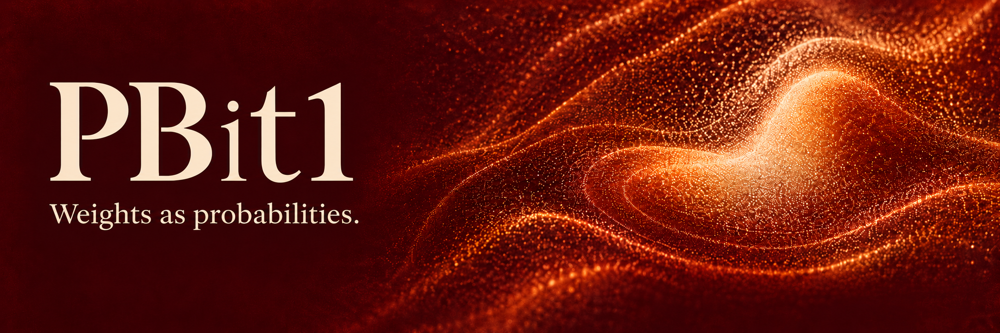
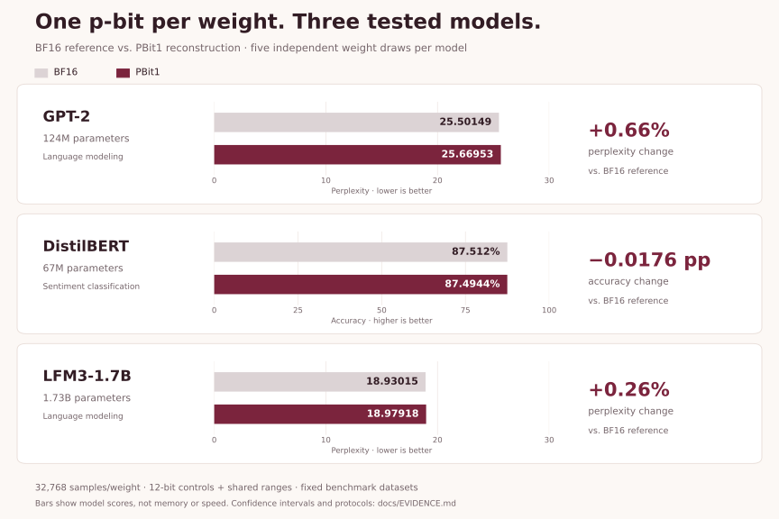

<p align="center">
  
</p>

<p align="center">
  <sub>Independent research. Not affiliated with or endorsed by Extropic.</sub>
</p>

# One p-bit per parameter

**The experiments behind PBit1, explained.**

When can one probabilistic element per learned weight preserve neural-network
task quality? This repository investigates when that works, why it sometimes
fails, and what it costs.

A weight of `0.7` can be represented by an element that outputs `1` about 70% of
the time. Averaging samples estimates the weight. Signed weights use a shared
range. The challenge is preserving model quality with finite controls and a
reasonable sampling budget.

## Start here

| You want to… | Open this |
|---|---|
| Understand the idea in plain language | [Research overview](docs/OVERVIEW.md) |
| Check a claim against its evidence | [Results and evidence map](docs/EVIDENCE.md) |
| Rebuild figures or rerun experiments | [Reproduction guide](REPRODUCING.md) |
| Use the Python package | [Public PBit1 SDK](https://github.com/oramada/pbit1) |

## What we found

Selected configurations converted every learned scalar in GPT-2, DistilBERT,
and LFM3-1.7B—including biases and normalization parameters—and passed their
predefined task-quality margins against BF16.

<picture>
  <source media="(max-width: 600px)" srcset="docs/assets/product_benchmarks_mobile.svg">
  
</picture>

- **Range grouping matters.** GPT-2 initially failed; changing how weights share
  local ranges repaired the tested failure at the same sample count.
- **Sampling can be allocated.** A separate GPT-2 policy used 41.7% fewer nominal
  reconstruction observations while passing the same quality margin.
- **One p-bit does not mean one bit of total storage.** Probability controls,
  shared ranges, and reconstructed weights have additional costs.
- **The limits are part of the result.** The finite format cannot reproduce
  every BF16 value exactly. Physical hardware energy and latency remain unmeasured.

These are five-draw software evaluations on fixed, previously inspected datasets.
Full-model runs reconstruct weights and then use ordinary BF16 neural operators.
Official THRML validation is at operator scale. [Read the exact conditions](docs/EVIDENCE.md).

## Try the reproducible parts first

Check the repository files using only Python and Git:

```bash
git clone https://github.com/oramada/pbit1-research.git
cd pbit1-research
python tools/verify_repository.py
```

Rebuild the overview chart without model weights or a GPU:

```bash
python -m pip install -r requirements-figures.txt
python tools/plot_overview.py
```

To reproduce full model experiments, follow
[REPRODUCING.md](REPRODUCING.md). Large checkpoint files, dataset tokens, and most
raw model outputs are omitted from Git; hashes and restoration requirements are
preserved. Summary files alone cannot reproduce raw-output audits.

## Where things live

| Directory | Purpose |
|---|---|
| [`research/`](research/) | Research implementations and experiment runners |
| [`results/`](results/) | Compact results, protocols, audits, and source snapshots |
| [`archive/`](archive/README.md) | Preserved earlier experiments, including failures and interrupted runs |
| [`sdk/`](sdk/) | The SDK snapshot used for this research; current package development is [here](https://github.com/oramada/pbit1) |
| [`master_design.tex`](master_design.tex) | Original plan; proposed experiments are not all completed results |

The scientific results and historical protocols are preserved. Current guides
explain how to read them; [publication history](provenance/README.md) records the
transition from the initial private snapshot to this public repository.

## Status and license

This repository contains research code and reproducible experimental artifacts.

[Apache-2.0](LICENSE) for original code · [Third-party notices](NOTICE) ·
[Citation](CITATION.cff) · [Research report](SPARK_RESEARCH.md)

Model and dataset licenses remain separate. No Extropic affiliation or endorsement
is claimed.
