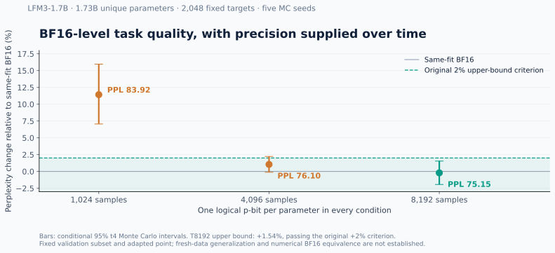
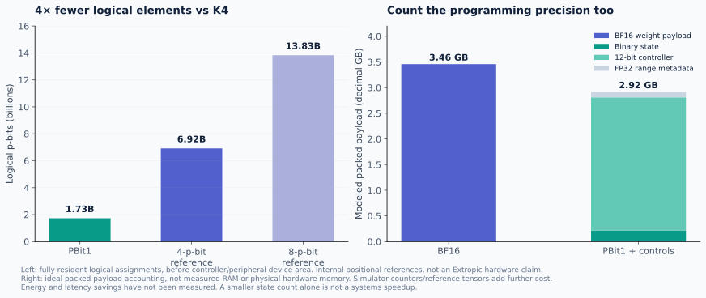

# PBit1 · experimental archive

**Frozen research sources, complete five-seed LFM3 reports, source hashes,
and an explicit record of both successful and unsuccessful conditions.**

## Latest completed Spark investigation

The [November 6 final research update](updates/20261106_spark_final/README.md) contains three complete model/task quality checks, independent replays, layer/covariance studies, and a verified 41.7% reduction in nominal sampling work. The [earlier core snapshot](updates/20261106_spark_core/README.md) is preserved. These are scoped software results; universal BF16 numerical equality and physical energy advantages are not established.

## Earlier adapted LFM3 result

One logical p-bit per each of **1,728,801,536** unique parameters of
LiquidAI/LFM3-1.7B. Five Monte Carlo seeds on the same **2,048 fixed targets**:

| Samples | Mean perplexity | Same-fit BF16 | PPL ratio, MC95 interval | Original 2% upper-bound gate |
|---:|---:|---:|---:|:---|
| 1,024 | 83.9167 | 75.3147 | 1.1142 [1.0706, 1.1596] | Missed |
| 4,096 | 76.1024 | 75.3147 | 1.0105 [0.9988, 1.0223] | Missed |
| **8,192** | **75.1547** | **75.3147** | **0.9979 [0.9806, 1.0154]** | **Passed** |

The T8192 result passes the original conditional validation criterion.
Intervals quantify Monte Carlo variability on these fixed texts, not general
deployment uncertainty. Additional adaptation is shared by the BF16 control.
Smaller budgets, previous failures and hardware costs remain visible.

## Find the evidence

- [Machine-readable figure data](benchmarks/lfm3.json).
- [T8192 full statistics](results/thrml_spw/lfm3_1p7b/counted_mean_t8192/statistics.json)
  and [independent audit](results/thrml_spw/lfm3_1p7b/counted_mean_t8192/statistics_audit.json).
- Per-seed `results.json`, `protocol.json`, `independent_audit.json` for all three budgets.
- [Model coverage](results/thrml_spw/lfm3_1p7b/meta_inventory.json),
  [resource accounting](results/thrml_spw/lfm3_1p7b/language_resource_model/results.json),
  and [H100 bridge review](results/thrml_spw/modal_h100_v1/parity_review_v1/review.json).
- [Original experimental design](master_design.tex), [research log](research/thrml_spw/RESEARCH_LOG.md),
  and [dated README history](docs/RESEARCH_HISTORY.md).
- `results/thrml_spw/source_snapshots/` contains executed historical source bytes.
  `FILES.sha256.json` authenticates the files included in this snapshot.

## Reproduction

The [installable SDK](https://github.com/oramada/pbit1) runs the small official
THRML example without model assets. This archive preserves the larger
`research/`, `cloud/`, `weight_encodings/`, and environment lock files.
THRML is pinned to `2d54cd8404df85bb65703d7e8b4e84e48c1b72a9`;
the LFM3 revision is `ac2586a34f1a1c03329dbdcdefabd8b6478ddaa7`.

Recreate the CPU/GPU environments from the lock files, prepare the pinned
checkpoint and datasets, and use each protocol's source/input hashes.
Run in a new workspace: output namespaces use exclusive creation to retain
failures. This bounded snapshot omits checkpoint weights, dataset tokens,
full-model logits and raw trajectories. Their original hashes are retained.
Summary JSON alone is not a self-contained rerun of raw-output audits.

## Current boundary

Cross-GPU stochastic/nominal arrays matched exactly. BF16 control bits
differed; the same-fit mean shift was about 0.00515% in perplexity. The
original failed strict bridge is preserved; a later explicit amendment uses
H100-specific references while retaining the 2% quality margin.

Fresh 10,240-target evaluation has no accepted quality result in this
snapshot. Its first execution failed on a normalization activation-rank
assertion; this is not counted as a completed experiment. Further H100
matched-resource work remains outside the completed-result claim.
This is not numerical BF16 equivalence, physical hardware validation,
measured energy savings, or a universal inference guarantee.

## License and provenance

Apache-2.0 for original project code. Third-party model, dataset and
dependency licenses remain separate; see [NOTICE](NOTICE).
Independent research using Extropic's official simulator, without endorsement.

**Topics:** `pbit1` `fp1` `p-bit` `extropic` `thrml` `probabilistic-computing`
`stochastic-computing` `neural-networks` `quantization` `bf16` `monte-carlo`
`llm-inference` `liquid-neural-networks` `research` `reproducibility`.
