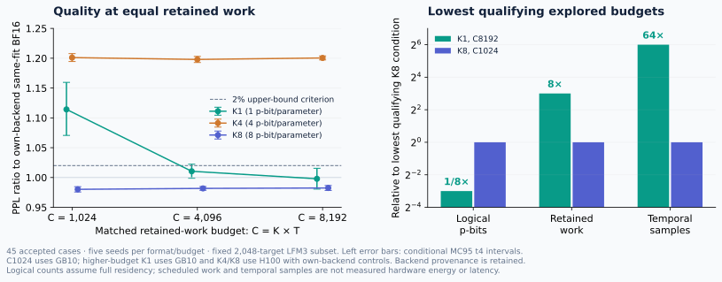

# Broad verification · 2026-11-05

The complete matched-work analysis now covers **45 accepted cases**, with five seeds for every format/budget condition. An independent Decimal audit checks original case bindings, controls, statistical intervals, parameter-point hashes, backend labels and retained/warmup work. No duplicate H100 replay key is pooled as an extra seed.

| Budget C | Format | GPU backend | PPL | Upper MC95 PPL ratio to own BF16 | Original 2% gate |
|---:|:---|:---|---:|---:|:---|
| 1,024 | K1 | GB10 | 83.9167 | 1.1596 | Missed |
| 1,024 | K4 | GB10 | 90.4592 | 1.2077 | Missed |
| 1,024 | K8 | GB10 | 73.8239 | 0.9847 | Passed |
| 4,096 | K1 | GB10 | 76.1024 | 1.0223 | Missed |
| 4,096 | K4 | H100 | 90.2283 | 1.2031 | Missed |
| 4,096 | K8 | H100 | 73.9443 | 0.9849 | Passed |
| 8,192 | K1 | GB10 | 75.1547 | 1.0154 | Passed |
| 8,192 | K4 | H100 | 90.4163 | 1.2038 | Missed |
| 8,192 | K8 | H100 | 73.9985 | 0.9867 | Passed |

All conditions use the same adapted point and 2,048 fixed targets. C1024 uses complete GB10 cohorts. Higher-budget K1 is GB10 and K4/K8 are H100 with backend-specific BF16 controls. Cross-format contrasts are descriptive, with both raw NLL and own-control gap differences reported. Tiny CPU float64 reduction differences are retained as per-seed control values. These are conditional exploratory comparisons, not fresh-data results or a universal guarantee.

**The supported tradeoff:** K1 meets the criterion at the lowest explored qualifying budget C8192; K8 meets it at C1024. This corresponds to eight times fewer logical p-bits for K1, but eight times more retained scheduled work and 64 times more temporal samples than that K8 condition. K4 misses the quality gate at all three explored budgets. No measured energy or hardware latency advantage follows from these counts.

## Repaired full-data evaluation

The first attempt failed when a rank-three frontend encountered per-head attention normalization. The versioned frontend now passes actual model forwards at 8×65 and 4×257, all 287 weighted module uses, and 12 canonical layout fixtures including rank-four head axes. CPU, GB10 and H100 component audits matched 4,194,304 public sampler bits and 3,962,880 integer/FP64 outputs exactly.

The first two short articles had completed BF16 control evaluation before the original failure. An exposure ledger records those 512 targets. The new protocol keeps all 10,240 targets/40 articles and separately analyzes the 9,728 previously unexposed targets/38 articles. Both reports must meet the unchanged 2% criterion with conditional MC and crossed article/seed bootstrap bounds for short,long,andpooled. Five fresh keys are 202611150–202611154. The first H100 case is running; no completed fresh-data quality claim is made.

## Additional model selection, before scores

- [GPT-2](https://huggingface.co/openai-community/gpt2): 124,439,808 unique learned scalars, including 102,144 bias values; planned language-model evaluation on the pinned WikiText-2 test corpus.
- [DistilBERT SST-2 checkpoint](https://huggingface.co/distilbert/distilbert-base-uncased-finetuned-sst-2-english): 66,955,010 unique learned scalars, including 52,226 bias values; planned domain-shift sentiment evaluation on the [IMDb test set](https://huggingface.co/datasets/stanfordnlp/imdb).

Checkpoint/dataset revisions, file hashes, alias inventories, complete parameter coverage, samples, seeds and primary quality criteria were selected before any new-model quality evaluation. Complete implementation/component/data/statistical execution gates are still required. R1 reconstruction and R2 operator execution are separate regimes and will be reported separately; an R1 result cannot establish R2 hardware costs.

## Inspect and verify

`INDEX.json` maps original paths to preserved archive artifacts and SHA256 digests. The original repository-root `FILES.sha256.json` and the `snapshot-20261031` release remain unchanged. This update has its own `FILES.sha256.json`. Checkpoints, dataset arrays, raw logits and trajectories remain outside GitHub; the included audits preserve their original hashes.

The broad-verification goal remains active. Additional models/tasks, nonideality operating regimes and practical systems accounting remain required. Physical hardware access is required for measured device energy/latency claims.
