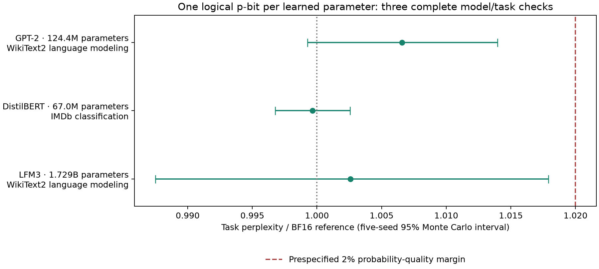
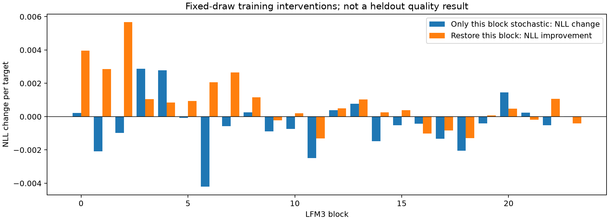
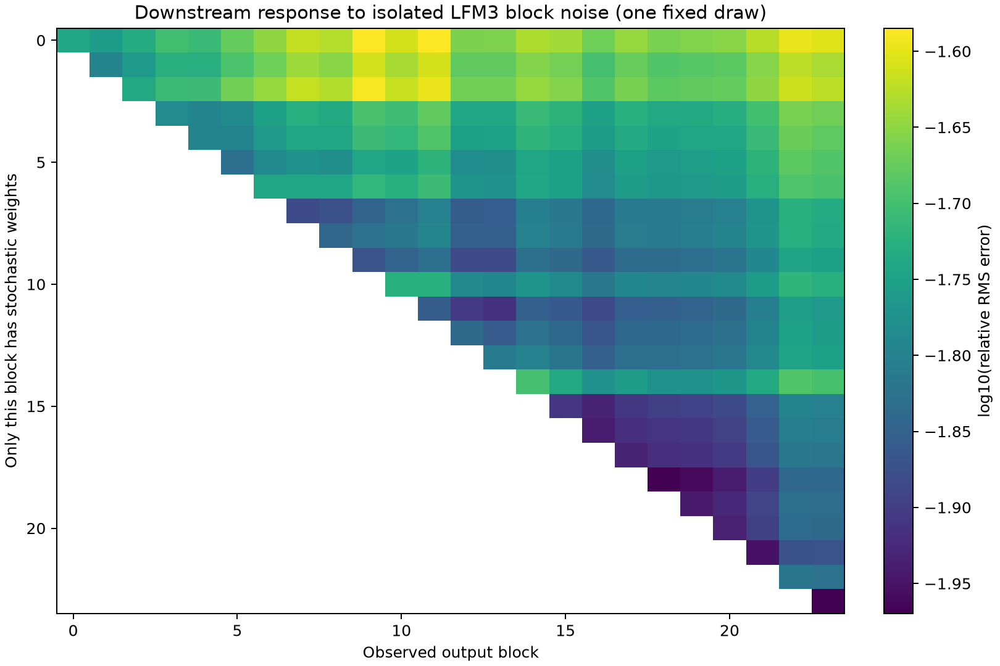
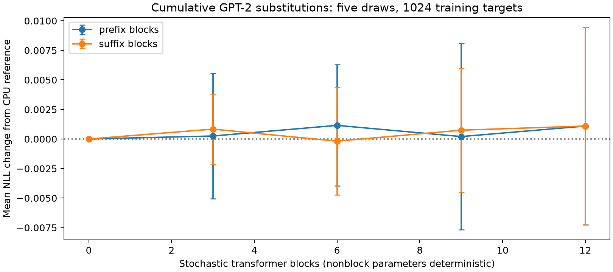
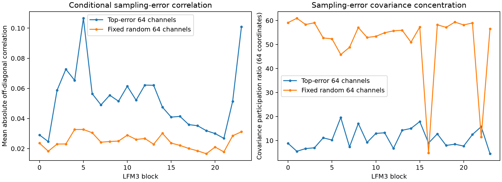
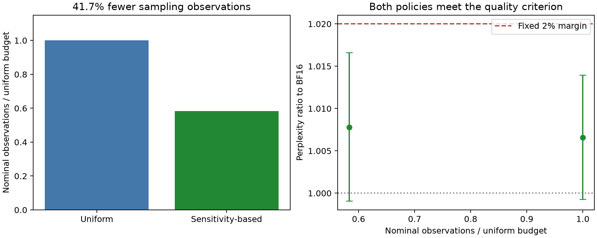
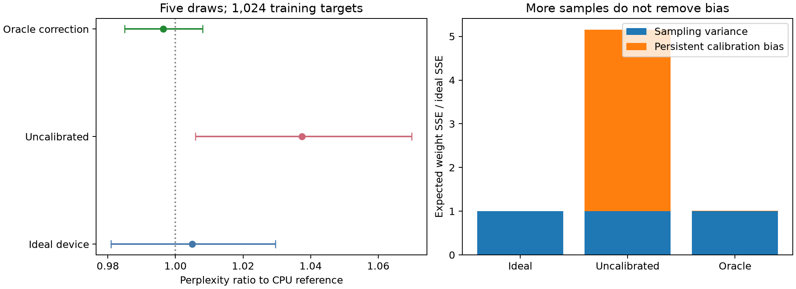

# Single-p-bit weights: DGX Spark research report

The tested one-p-bit encoding reaches the predefined BF16 task-quality margins on three complete model/task evaluations. We identified and repaired a concrete GPT-2 failure caused by range grouping, then verified a sampling allocation that reduces nominal reconstruction observations by 41.7% while retaining the quality criterion.

These are software weight-reconstruction results. One logical p-bit per learned scalar is accompanied by finite probability commands and shared range metadata. This is not a one-bit model file, universal numerical BF16 equivalence, or a measured physical-hardware advantage. A stronger four-element control gives better operator accuracy with additional physical elements and stored information.

## Accepted model results

| Checkpoint/task | Unique learned scalars | Original BF16 | Selected K1 | Five-seed probability-quality ratio and MC95 interval |
|---|---:|---:|---:|---|
| GPT-2 / 283225 WikiText2 targets | 124439808 | PPL 25.501486 | PPL 25.669535 | 1.006590 [0.999267, 1.013967] |
| DistilBERT / 25000 IMDb reviews | 66955010 | Accuracy 87.512% | Mean accuracy 87.4944% | Categorical PPL ratio 0.999656 [0.996759, 1.002563] |
| LFM3 / 294442 WikiText2 targets | 1728801536 | PPL 18.930155 | PPL 18.979177 | 1.002590 [0.987510, 1.017899] |

All three pass their frozen criteria. The probability-quality criterion requires the upper endpoint of a five-seed t4 interval to be at most 1.02 relative to BF16. DistilBERT also passes its two-percentage-point accuracy criterion; the upper confidence bound on its accuracy decline is 0.08383 percentage points.

Every learned scalar is converted, including normalization and bias parameters. Tied embedding/head weights are counted once. Each condition uses 32768 samples and 12-bit probability commands. Range layouts are selected from training activations; LFM3 uses groups of seven for depthwise filters and groups of sixteen for normalization tensors, with groups of 128 for matrices. No additional fine-tuning was needed for these tested criteria.



These are three checkpoint/task checks on two previously inspected benchmark tasks, not an unseen-task or universal-architecture guarantee. GPT-2 and LFM3 use their own tokenizers. Language-model PPL is reported at mean NLL across seeds; DistilBERT's probability metric is categorical perplexity, not language-model perplexity.

[Three-model summary](results/thrml_spw/spark_depth_20261106/cross_model_summary_v2/results.json) · [GPT-2 audit](results/thrml_spw/spark_depth_20261106/benchmark_audit_v1/results.json) · [DistilBERT audit](results/thrml_spw/spark_depth_20261106/distilbert_benchmark_audit_v1/results.json) · [LFM3 audit](results/thrml_spw/spark_depth_20261106/lfm3_benchmark_audit_v1/results.json)

## What failed, and what fixed it

The original flat range grouping harmed GPT-2's output head. A few large hidden features made noise in particular weight directions disproportionately important. In diagnostic experiments, restoring the output-head use of the tied matrix largely removed the degradation; restoring only its input-embedding use did not.

With clean hidden activations held fixed, changing grouping direction reduced predicted output-logit variance from 0.61444 to 0.002698, approximately 228-fold. This is an operator variance result, not a 228-fold system speedup. At the same full-model sample budget of 32768, original grouping gives a PPL ratio of 1.059637 and fails, while the selected grouping gives 1.006590 and passes.

The appropriate direction differs across operators and models. Blindly transposing one DistilBERT feed-forward matrix would increase its predicted output variance by about 3.2 times. The tested repair therefore chooses each operator's layout using training statistics.

[Head/embedding intervention study](results/thrml_spw/spark_depth_20261106/tied_head_v1/results.json) · [Activation-weighted predictions](results/thrml_spw/spark_depth_20261106/activation_variance_v1/results.json) · [Causal explanation](results/thrml_spw/spark_depth_20261106/explanation_v1/results.json)

## Layer and neuron investigation

The GPT-2 investigation traced all twelve transformer blocks, 144 attention heads, normalization outputs, MLP channels and logits. The LFM3 investigation measured all 24 blocks and 2048 hidden channels, then completed 55 fixed-draw isolated/restored-block and component-family interventions. Every isolated intervention left earlier blocks exactly unchanged. Its first weight draw reproduced all 286 count records, and six neural replay rows matched bitwise.

The most harmful isolated LFM3 block in that draw was block 3; restoring block 2 helped most in the fully stochastic model. These different rankings show why isolated-layer sensitivity is not simply additive. They are one-draw training diagnostics, not population-level rankings or separate all-K1 quality wins.





A five-seed GPT-2 cumulative study added early or late blocks in groups of three, six, nine and twelve. All 41 conditions were audited, with a separate SDK reconstruction and six neural row replays. Within its broad training-cohort intervals, loss did not increase monotonically with converted parameter count. Nonblock parameters remain deterministic in these particular prefix/suffix controls.



Relative error can fall without absolute error falling. Between LFM3 blocks 11 and 12, absolute error power increased by 20.8%, but signal power increased by 57.0%; relative RMS error consequently fell by 12.3%. We do not interpret this dip as denoising.

The baseline activation survey covers 8224 positions per block. Signal-energy participation ratios range from about 9 to 654 out of 2048 channels. This indicates uneven energy distribution, not that the remaining neurons can be pruned.

The conditional error-covariance study reconstructed all five original LFM3 training draws and replayed their 8192 scored targets each. It measured covariance across draws, conditional on each input, then averaged over input positions. All 48 covariance matrices and their trace diagonals passed the independent audit. In the 64 high-error channels, mean absolute off-diagonal correlation ranges from 0.0246 to 0.1066; corresponding random-channel subsets range from 0.0166 to 0.0327. The high-error subsets have covariance participation ratios of 4.5 to 19.6. These are descriptive training-subset measurements, not full 2048-dimensional covariance or out-of-distribution claims.



[Layer audit](results/thrml_spw/spark_depth_20261106/lfm3_causal_depth_analysis_v1/results.json) · [Cumulative audit](results/thrml_spw/spark_depth_20261106/gpt2_cumulative_v1_audit.json) · [Covariance audit](results/thrml_spw/spark_depth_20261106/lfm3_error_covariance_v2_audit.json)

## Sampling allocation

A training-gradient-based allocation keeps one p-bit for every GPT-2 scalar while assigning different sample counts to parameter groups. Using groups of sixteen for the small normalization/bias vectors adds 53088 bytes of range metadata and keeps maximum T at 32768.

On the complete 283225-target task, five fresh draws give a PPL ratio of 1.007797 with MC95 interval [0.999069, 1.016601], passing the same 2% criterion. Nominal sampling observations per model reconstruction decrease from 4077643628544 to 2378245865472: a 41.676% reduction. All six weight points, 740 stochastic parameter count hashes, and eighteen neural replay windows matched through the separate SDK.



The uniform and reduced-work measurements use separate five-seed cohorts. Both satisfy the same margin; this is not proof of identical quality or a 41.7% reduction in physical energy or inference latency. These are R1 reconstruction budgets, reused across task inputs.

[Budget/output audit](results/thrml_spw/spark_depth_20261106/reduced_work_gpu_v1_audit.json) · [Independent replay](results/thrml_spw/spark_depth_20261106/reduced_work_replay_v1/results.json)

## Negative controls and device errors

A full-model Gaussian control matches the finite-controller mean and per-coordinate binomial variance before reconstruction rounding. Across five CPU training draws on 1024 targets, Bernoulli reconstruction gives a PPL ratio of 0.99688 [0.98409, 1.00984], versus Gaussian 1.00406 [0.98855, 1.01981]. This supplies no clear Bernoulli-specific quality advantage and does not prove statistical equivalence.

A separate full-model device-error study uses illustrative gain SD 0.02 and logit-offset SD 0.02. Uncalibrated controls give PPL ratio 1.03743 [1.00595, 1.06991]; oracle-corrected controls give 0.99643 [0.98501, 1.00798]. The oracle knows the true device coefficients, requantizes the commands and reduces systematic weight-error SSE by about 447 times. Ordinary averaging cannot remove this systematic bias. Retaining two FP32 calibration coefficients per GPT-2 parameter would add 995518464 bytes; a hardware design must account for where such information resides.



Native/operator studies also cover temporal correlation, shared noise, drift and finite calibration probes. In the tested head model, a prior-aware fit improved calibration where an unregularized fit could worsen it. The assumed prior is not a measured device population; probe costs and calibration overhead are counted.

[Gaussian audit](results/thrml_spw/spark_depth_20261106/gaussian_control_v3_audit.json) · [Device-error audit](results/thrml_spw/spark_depth_20261106/gpt2_calibration_control_v1_audit.json) · [Calibration-probe audit](results/thrml_spw/spark_depth_20261106/calibration_prior_audit_v1/results.json)

## Spatial and temporal costs

The original four-bit-word reference has less control information than the 12-bit probability encoding. A stronger native THRML control combines three clamped coarse bits with one programmable fractional p-bit: its normalized value is `(q + z)/8`. This is an internal comparison, not Extropic's proprietary representation.

| Reoriented real head bank | Physical/logical elements | Samples | Scheduled node observations | Free-node updates | Mean output MSE |
|---|---:|---:|---:|---:|---:|
| K1 | 6144 | 32768 | 201326592 | 201326592 | 7.0041e-5 |
| K4 coarse/fractional | 24576 | 8192 | 201326592 | 50331648 | 3.3115e-6 |
| K4 coarse/fractional | 24576 | 32768 | 805306368 | 201326592 | 5.6909e-7 |

All thirty native cases were audited, and three native trajectories replayed bitwise. Exact binomial moment calculations account for correlations between input vectors sharing a sampled weight. The moment formula also matches exhaustive enumeration of a small sixteen-outcome problem.

The stronger K4 control achieves lower operator error at the same scheduled observation count, using more elements and coarse command information. The earlier word-baseline comparison therefore does not establish general K1 accuracy or efficiency dominance. Clamped nodes do not make random transitions; their reads, programming and holding costs must be distinguished from free-node updates. Counting the coarse commands, probability commands and binary states separately gives nineteen bits per K4 scalar before common ranges, versus thirteen for K1. Actual hardware can store these controls differently.

For GPT-2 with groups of 128, ideal packed 12-bit commands, two FP32 range values per group, binary state and small policy metadata occupy about 84.375% of the BF16 weight payload. Using uint16 command arrays instead gives about 109.375%, before decoded BF16 working weights, counters and framework storage. The Python implementation does not store the model in one bit per weight.

R1 samples weights once and reuses the reconstructed matrix. Direct stochastic operators would pay sampling/readout/accumulation costs when executed. Native tests found exact linear-operator agreement between reconstruct-first and sample-and-accumulate on the same trajectories; reordering the same samples provides no free variance reduction. Physical programming, readout, accumulation, leakage, calibration, device capacity and sampling-rate costs remain necessary for an energy/latency conclusion.

[Four-configuration resource ledger](results/thrml_spw/spark_depth_20261106/resource_ledger_final_v1.json) · [Detailed GPT-2 resource ledger](results/thrml_spw/spark_depth_20261106/resource_ledger_v1/results.json) · [Strong K4 audit](results/thrml_spw/spark_depth_20261106/native_coarse_fractional_v1_audit.json) · [Correlated-output moment audit](results/thrml_spw/spark_depth_20261106/native_coarse_fractional_moments_v1.json)

The final ledger counts commands, ranges, conceptual binary states, decoded working weights and nominal sampling work for all three accepted models and the lower-work GPT-2 policy. Shape/addressing policy, framework objects and transient tensors are additional; the ledger is not a measurement of full process memory or physical chip area. For LFM3, commands and ranges occupy 2,701,541,888 bytes with ideal 12-bit packing, or 3,565,942,656 bytes using the implemented uint16 command arrays, before binary states and decoded working weights.

## Numerical precision boundary

The current finite-controller encoder has an executed collision: two different BF16 values, 2^-20 and 2^-19 in the tested range group, generate identical complete encoded programs. Unlimited sampling cannot distinguish them. A capacity argument also excludes a universal lossless mapping of arbitrary BF16 tensors into this fixed controller/range format.

Task-quality agreement is therefore different from bitwise or per-parameter BF16 equivalence. We demonstrated the former in the listed regimes and did not demonstrate the latter.

[Executed precision counterexample](results/thrml_spw/spark_depth_20261106/precision_limits_v1/results.json) · [Capacity argument](results/thrml_spw/spark_depth_20261106/precision_limits_v1/capacity_note.md)

## Reproduction and scope

The installable SDK lives in [publish/pbit1](publish/pbit1/README.md). It provides the NumPy finite-program encoder/reconstructor and an optional official THRML p-bit bank. Softmax remains part of ordinary neural execution; the weight probabilities are independent Bernoulli parameters set through bias fields. The large-model runs use exact independent-binomial count sampling, while the native operator tests use THRML itself.

Research sources are under `research/thrml_spw/spark_depth/`; accepted outputs, protocols and audits are under `results/thrml_spw/spark_depth_20261106/`. Source snapshots preserve exact executed bytes, including unsuccessful and interrupted attempts. The [chronological research log](results/thrml_spw/spark_depth_20261106/research_history_v1/SPARK_RESEARCH.md) is retained separately.

The [final experimental archive](publish/pbit1-experiments/updates/20261106_spark_final/README.md) includes the completed evidence and installable development package; the earlier [core archive](publish/pbit1-experiments/updates/20261106_spark_core/README.md) is preserved. Raw checkpoints, token arrays and large trajectories are omitted with hashes; their licenses and storage requirements are separate. Summary JSON alone does not reproduce a raw-output audit. Local runs use the shared GB10, serial research GPU jobs and a 2 GiB allocator cap. Modal/cloud jobs remain stopped; unrelated workloads were not stopped by this work.

Representative checks, after restoring the pinned assets and environments:

```bash
.venv/bin/python -m research.thrml_spw.spark_depth.audit_lfm3_benchmark_v1
.venv/bin/python -m research.thrml_spw.spark_depth.replay_lfm3_benchmark_v1
.venv/bin/python -m research.thrml_spw.spark_depth.audit_reduced_work_gpu_v1
.venv/bin/python -m research.thrml_spw.spark_depth.replay_reduced_work_gpu_v1
.venv-thrml/bin/python -m research.thrml_spw.spark_depth.audit_lfm3_error_covariance_v1
python3 publish/pbit1-experiments/updates/20261106_spark_final/verify_archive.py
```

Physical validation remains future work: measure bias/probability transfer, control precision, drift, temporal and cross-device correlation, programming retention, readout/accumulation costs, then compare matched-quality operators on actual devices. Broader models, tasks, long-context generation and changing-weight/cache interactions also require separate evaluation. The completed research provides tested success regimes and concrete failure mechanisms, not a universal hardware replacement guarantee.
