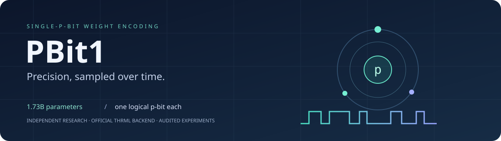
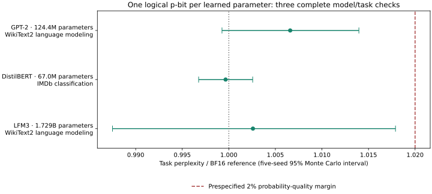
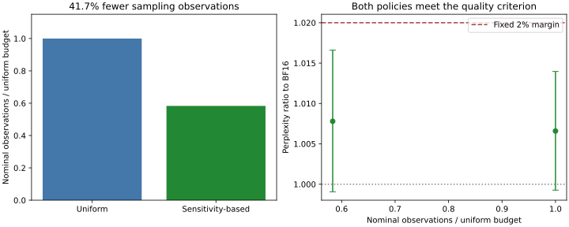
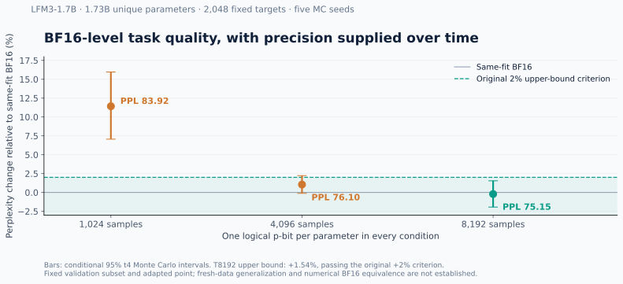
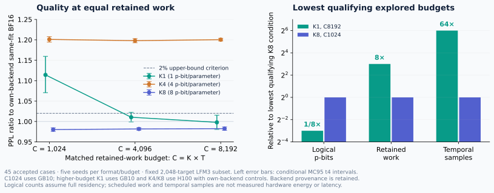
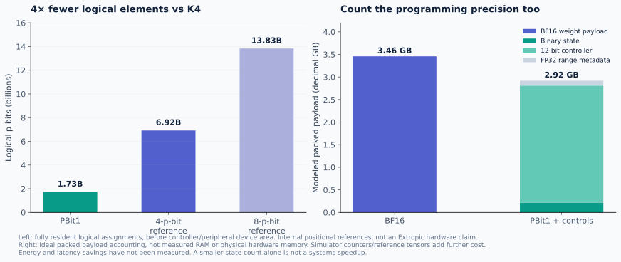
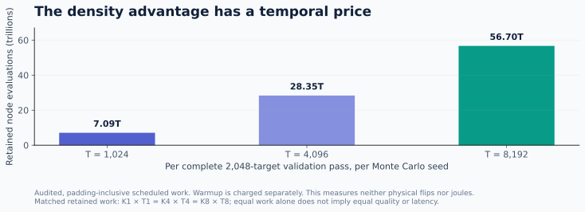

<p align="center">
  
</p>

<p align="center">
  <a href="LICENSE"></a>
  <a href="https://github.com/oramada/pbit1/releases"></a>
  <a href="pyproject.toml"></a>
  <a href="https://github.com/extropic-ai/thrml/tree/2d54cd8404df85bb65703d7e8b4e84e48c1b72a9"></a>
  <a href="https://github.com/oramada/pbit1-extropic"></a>
  <a href="https://github.com/oramada/pbit1/actions/workflows/ci.yml"></a>
</p>

<p align="center">
  <b>One programmable p-bit per learned parameter. Precision supplied over time.</b><br>
  <a href="#the-result">Results</a> · <a href="#install">Install</a> ·
  <a href="#try-it">Quickstart</a> · <a href="#the-cost-tradeoff">Costs</a> ·
  <a href="docs/EXTROPIC_BRIEF.md">Technical brief</a> ·
  <a href="https://github.com/oramada/pbit1-extropic">Experimental archive</a>
</p>

PBit1 is an independent research SDK for representing a weight through the
stationary probability of a programmable probabilistic bit. It includes NumPy
reference encoders, nonideality models, and an integration with **Extropic’s official
THRML simulator**. The accompanying research converts every learned parameter in
**LiquidAI/LFM3-1.7B** and measures the spatial–temporal precision tradeoff.

## The result

**November 6 local DGX Spark update:** repaired one-p-bit encoding passes the
prespecified quality criteria on **three complete model/task evaluations**.
These are ideal independent-count reconstruction experiments with BF16 neural
execution, separate from the earlier adapted LFM3 experiment below.

| Full model/task | BF16 | Operator-aware K1 | Five-seed result |
|:---|---:|---:|:---|
| GPT-2 · 283,225 WikiText2 targets | 25.50149 perplexity | 25.66953 perplexity | Ratio **1.00659**; MC95 **[0.99927, 1.01397]**, passes 2% limit |
| DistilBERT · 25,000 IMDb reviews | 87.512% accuracy | 87.4944% mean accuracy | Upper MC95 accuracy decline **0.08383 percentage points**, passes 2-point limit |
| LFM3-1.7B · 294,442 WikiText2 targets | 18.93015 perplexity | 18.97918 perplexity | Ratio **1.00259**; MC95 **[0.98751, 1.01790]**, passes 2% limit |

Every learned scalar uses K1, including normalization and bias parameters. All
three use 32,768 samples and finite 12-bit probability controls. GPT-2 has
124,439,808 unique parameters, DistilBERT 66,955,010, and LFM3 1,728,801,536.
Training activation measurements choose local range layouts; LFM3 also uses
finer groups for convolution filters and normalization tensors. Metadata costs
remain additional to the one physical binary state.

At the same sample budget, original-layout GPT-2 still fails: its perplexity
ratio is **1.05964**. The layout repair matters. All GPT-2 and DistilBERT weight
points and 36 neural replay batches per architecture matched bitwise. All seven
LFM3 weight points and 21 prespecified neural windows also matched using a
separate SDK reconstruction, checking 1,430 per-parameter count hashes.
These are previously inspected test datasets, not newly unseen data.



[Cross-model results](benchmarks/spark_cross_model_20261106.json) ·
[GPT-2 audit](benchmarks/spark_gpt2_audit_20261106.json) ·
[DistilBERT audit](benchmarks/spark_distilbert_audit_20261106.json) ·
[LFM3 audit](benchmarks/spark_lfm3_audit_20261106.json) ·
[LFM3 independent replay](benchmarks/spark_lfm3_replay_20261106.json)

LFM3 ran with CPU weight offloading under a 2 GiB GPU allocator cap. Its 24-block
channel analysis and 55 fixed-draw causal interventions are diagnostic evidence,
not separate all-K1 quality wins. Universal numerical BF16 equivalence, full-model
native THRML execution, and physical hardware savings remain unproven. Modal jobs
are stopped.

A further five-seed GPT-2 study uses **41.7% fewer nominal sampling observations**
while satisfying the same quality margin: PPL ratio **1.00780**, MC95
**[0.99907, 1.01660]**. It adds 53,088 bytes of range metadata and keeps the
maximum sample count at 32,768. All six weight points and 18 neural replay
windows matched independently. This is a reduction in R1 reconstruction work;
physical energy and inference latency were not measured.



[Sampling-budget results](benchmarks/spark_reduced_work_20261106.json) ·
[Detailed Spark verification](docs/SPARK_VERIFICATION.md)

The **unreleased 0.1.0a2.dev1** working tree includes a finite-control NumPy program API
matching the frozen research sampler; see [its scope and example](docs/FINITE_PROGRAM.md).

## Earlier adapted LFM3 result

**At 8,192 samples, one logical p-bit per parameter passed the original 2% task-quality
criterion against same-fit BF16 across five Monte Carlo seeds.**

| Model coverage | One-p-bit perplexity | Same-fit BF16 perplexity | Upper MC95 degradation |
|:---|---:|---:|---:|
| **1,728,801,536 unique parameters** · 286 canonical tensors | **75.1547** | **75.3147** | **+1.54%**, below the +2% criterion |



All conditions use the same adapted model point and **2,048 fixed teacher-forced
validation targets**. The mean perplexity ratio at T8192 is **0.99788**, with a
conditional 95% t4 Monte Carlo interval of **[0.98062, 1.01544]**. The interval
describes sampling variability on these texts; it is not a fresh-data guarantee or
proof of numerical BF16 precision. BF16 receives the same adapted expected weights,
so additional training is not counted as a representation gain.

Smaller budgets are included: T1024 missed the criterion; T4096 narrowly missed it.
The [experimental archive](https://github.com/oramada/pbit1-extropic) preserves
all three complete cohorts, independent audits, protocols and source hashes.
[Machine-readable figure data](benchmarks/lfm3.json) links directly to that evidence.

**Cross-GPU replay:** the completed K8 spatial-control GB10/H100 bridge produced bit-identical
stochastic and nominal arrays. Its BF16 reference shifted about **0.00515% in
perplexity**. A documented later amendment uses H100-specific BF16 controls while
keeping the original 2% task-quality threshold. The original strict bitwise-control
failure is retained in the archive.

## Verification update · November 5

The completed matched-resource analysis now covers **45 accepted cases** with independent statistical auditing. K1 meets the original quality criterion at C8192; K8 meets it at C1024. Relative to that K8 condition, K1 uses **8× fewer logical p-bits**, **8× more retained scheduled work**, and **64× more temporal samples**. This supports a density/time tradeoff, without establishing hardware energy or latency savings.



The historical November 5 verification included a failed GPT-2 cohort at
8,192 samples and a passing DistilBERT cohort. Those failures remain in the
archive. The repaired 10,240-target LFM3 study was interrupted by Modal
preemption. Subsequent cloud jobs have been stopped; the current investigation
uses the local DGX Spark. The completed local results above supersede earlier
“running on H100” status messages without erasing their outcomes.
[Historical verification details](docs/BROAD_VERIFICATION_20261105.md).

## Install

The NumPy SDK needs Python 3.12+:

```bash
python -m pip install "pbit1 @ git+https://github.com/oramada/pbit1.git@v0.1.0a1"
```

To include the pinned official CPU THRML backend:

```bash
python -m pip install "pbit1[thrml] @ git+https://github.com/oramada/pbit1.git@v0.1.0a1"
python -m pbit1 --samples 256 --chains 4
```

Wheels and source distributions are available in
[GitHub Releases](https://github.com/oramada/pbit1/releases). This release is
installable from GitHub; it is not advertised as a published PyPI distribution.
The optional simulator extra pins THRML commit
`2d54cd8404df85bb65703d7e8b4e84e48c1b72a9` and the tested dependency versions.
Its installation requires GitHub access and a platform supported by JAX.

## Try it

For weights in `[0,1]`, assign one logical THRML p-bit to each probability:

```python
import numpy as np
from pbit1 import NativeProbabilityBank

weights = np.array([0.1, 0.5, 0.9])
bank = NativeProbabilityBank(weights)  # three logical p-bits; target p = weight
states = bank.sample(seed=7, n_samples=1024, n_chains=4)

estimated_weights = states.mean(axis=(0, 1))
x = np.array([1.0, -0.5, 0.25])
estimated_output = (states @ x).mean()
print(estimated_weights, estimated_output, bank.controls())
```

For signed weights, use shared affine ranges with the NumPy reference encoder:

```python
from pbit1 import SinglePBit

codec = SinglePBit(eps=0)
weights = np.array([[-0.7, 0.2], [0.3, 0.8], [-0.1, 0.4]])
encoded = codec.encode(weights)
output = codec.forward(
    np.array([[1.0, -0.5, 0.25]]), encoded,
    n_samples=8192, rng=np.random.default_rng(7),
)
```

The NumPy reference sampler and official THRML backend are separate implementations.
The SDK exposes the encoding primitives; the full LFM3 conversion and GPU research
worker are in the [archive](https://github.com/oramada/pbit1-extropic).
See [API details](docs/API.md) and the runnable [quickstart](examples/quickstart.py).

## How it works

For a weight in `[0,1]`, program `p = w`, sample `z ~ Bernoulli(p)`, and estimate the
weight by averaging observations. For signed weights, share a center and radius:

$$w_i = c_g + r_g(2p_i-1),\qquad \widehat{w}_{i,T}=c_g+r_g\left(\frac{1}{T}\sum_t(2z_i^{(t)}-1)\right).$$

An isolated THRML spin uses bias `b = logit(p) / (2β)` to obtain the requested
stationary probability. Exact endpoint probabilities use clamped nodes. The
native bank reports float32 bias-control storage explicitly.

Temporal precision has a cost: for independent samples,
`Var(ŵ) = 4 r² p(1−p) / T`. In the full model, finite 12-bit commands and shared
FP32 ranges program the stochastic weights; ACT12 inputs and integer accumulation
feed BF16 nonlinearities. One logical p-bit per parameter does not mean the Python
simulator stores only one bit per parameter.

“FP1” is an informal project/search alias here. **PBit1** describes a programmable
probability representation; it is not an IEEE floating-point format.

## The cost tradeoff

One logical element instead of four gives **75% fewer logical p-bits** than the
internal K4 positional reference. That is the density opportunity being investigated.



The binary-state-only lower bound is 0.216 GB for this model. Counting ideal packed
12-bit controllers and FP32 range metadata brings the modeled payload to **2.918 GB**,
versus **3.458 GB** for BF16 weights. These are payload calculations, not physical
device area or measured simulator memory; counters, readout and reference tensors
add further costs. Conventional low-bit quantization can use less storage.



The successful T8192 validation pass schedules **56.7 trillion retained stochastic
node evaluations per seed**. Matched-work K4 uses T2048 and K8 uses T1024. Completed fixed-subset matched-resource comparisons are reported above; physical matched-quality systems measurements remain pending. Internal K4/K8 references are
not asserted to reproduce Extropic’s proprietary weight representation.

A stronger native THRML operator control also combines three fixed coarse bits
with one programmable fractional p-bit. It achieved lower dot-product MSE than
K1 at equal scheduled node observations, using four physical elements and extra
fixed-bit commands. Clamped elements do not undergo random transitions, so
scheduled reads and stochastic updates are counted separately. This demonstrates
that results depend on the spatial encoding and its control-information budget;
a favorable comparison with a four-bit word does not establish an advantage over
all four-element designs. [Strong spatial-control audit](benchmarks/spark_strong_spatial_control_20261106.json).

**Energy savings and hardware speedups are not measured.** The plots show where
spatial cost falls and temporal cost rises; they do not turn a logical device-count
reduction into an energy or latency claim.

## Project map

| Repository | Purpose |
|:---|:---|
| **[pbit1](https://github.com/oramada/pbit1)** | Installable SDK, examples, figures, API, package checks |
| **[pbit1-experiments](https://github.com/oramada/pbit1-extropic)** | Dated research snapshot, full cohort reports, protocols, source hashes, reproduction code |

The full experimental archive is currently **private**; access is required for its detailed artifacts. Public benchmark JSON and independent statistical audit summaries are included in this SDK.

The completed result is conditional validation. The 10,240-target study has no accepted full result yet; its original frontend failure is preserved; the repaired run was interrupted by platform preemption; the cloud jobs are now stopped. Completed H100 fixed-subset comparisons are included in the verification update.
Physical hardware, drift/calibration at model scale, broad model generalization,
and a drop-in BF16 replacement remain future work.

## Development

```bash
git clone https://github.com/oramada/pbit1.git
cd pbit1
python -m pip install '.[dev]'
python -m pytest -q
python tools/plot_results.py
python -m build
```

Install `.[thrml,dev]` to run the official-backend tests too. The native adapter is
byte-identical to the validated research implementation. Figure generation reads
the audited JSON snapshot rather than handwritten chart values.

## License and attribution

**Apache-2.0** · Copyright 2026 Omar Ramadan and PBit1 contributors.
See [LICENSE](LICENSE), [NOTICE](NOTICE) and [CITATION.cff](CITATION.cff).
THRML, checkpoint weights and datasets retain their own licenses.

This is independent research using Extropic’s official simulator. It is not
affiliated with or endorsed by Extropic or Liquid AI. Stochastic probability
encoding is established; this project investigates the model-level precision and
resource tradeoff. [Technical brief for probabilistic-hardware researchers](docs/EXTROPIC_BRIEF.md).

**Topics:** `pbit1` · `fp1` · `p-bit` · `extropic` · `thrml` ·
`probabilistic-computing` · `stochastic-computing` · `neural-networks` ·
`model-compression` · `quantization` · `bf16` · `monte-carlo` · `llm-inference` ·
`liquid-neural-networks` · `hardware-aware` · `python` · `research` · `reproducibility`.
