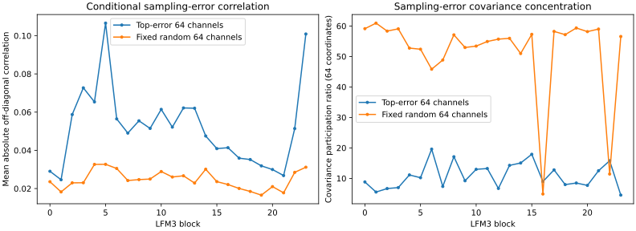

# DGX Spark verification

Three original checkpoint/task evaluations passed their frozen quality criteria with one logical p-bit for every learned scalar. Biases and normalization parameters were included; tied parameters were counted once. Each uses finite 12-bit probability controls and shared affine ranges. The evaluations use ideal independent-binomial weight reconstruction followed by conventional BF16 neural computation.

| Model/task | Parameters | Selected / BF16 probability-quality ratio | Five-seed MC95 interval |
|---|---:|---:|---|
| GPT-2 / WikiText2 | 124439808 | 1.006590 | 0.999267–1.013967 |
| DistilBERT / IMDb | 66955010 | 0.999656 | 0.996759–1.002563 |
| LFM3 / WikiText2 | 1728801536 | 1.002590 | 0.987510–1.017899 |

The classification probability metric is categorical perplexity. DistilBERT also passed its separate accuracy margin. These are previously inspected benchmark datasets; the claims do not extend automatically to new tasks, every model, or exact numerical BF16 equality.

## Why the original GPT-2 condition failed

Original flat range grouping placed too much error in sensitive output-head directions. Changing grouping direction according to training activations repaired the full-model result at the same sampling budget: original-layout PPL ratio 1.059637 versus repaired 1.006590. Restoring the head in isolated diagnostics also largely removed the failure. Different operators prefer different layouts.

## Layers and correlated error

LFM3 was examined at all 24 blocks and 2,048 hidden channels. Fifty-five fixed-draw interventions tested isolated blocks and restored blocks/component families. A separate five-seed cumulative GPT-2 study tested early/late block groups. These mixed deterministic/stochastic controls diagnose mechanisms; they are not additional all-K1 quality wins.

The conditional error-covariance study reconstructed five LFM3 training draws and replayed all 8,192 targets per draw. It measured two 64-channel subsets at each block. The high-error subset has more correlated and concentrated error than the random subset. Selection used the same training cohort; these are descriptive measurements, not population confidence bounds.

[Covariance measurements](../benchmarks/spark_error_covariance_20261106.json) · [Independent covariance audit](../benchmarks/spark_error_covariance_audit_20261106.json) · [Cumulative-layer audit](../benchmarks/spark_cumulative_20261106.json)

## Sampling budget and comparison fairness

The reduced-work GPT-2 policy passed the full 283,225-target task with five fresh seeds. It uses 58.324% of the uniform policy's nominal observations and 53,088 additional range bytes, with the same 32,768 maximum sample count. The complete output/budget audit and separate SDK reconstruction/neural replay passed.

[Budget audit](../benchmarks/spark_reduced_work_audit_20261106.json) · [Replay](../benchmarks/spark_reduced_work_replay_20261106.json)

A strong native THRML reference uses three fixed coarse bits and one probabilistic fractional bit. It achieves lower operator error than K1 at equal scheduled observations, while using more elements and information. Only its fractional element fluctuates, so scheduled reads and random updates must be counted separately. This is an internal reference, not Extropic's proprietary implementation. No hardware energy advantage is claimed.

## Software and hardware boundary

Our code maps weights to probability controls and ranges. Extropic supplies THRML's sampling implementation for native tests. Large-model experiments use a faster NumPy binomial-count simulator and PyTorch neural execution; no physical Extropic device has been tested. Softmax remains an ordinary neural operation, separate from the Bernoulli probability representing each weight.

The finite-controller implementation has explicit examples where distinct BF16 values produce identical programs. Sampling cannot recover information absent from the program. Thus passing task-quality margins does not make this a lossless BF16 or FP16 storage replacement.

The experiment archive preserves source versions, failed conditions, protocols and audit records. Large checkpoint/data arrays may be omitted with hashes, so a complete raw-output audit requires restored assets or a rerun. Physical validation still needs measured probability calibration, drift/correlation, readout/accumulation costs and matched-quality device measurements.
